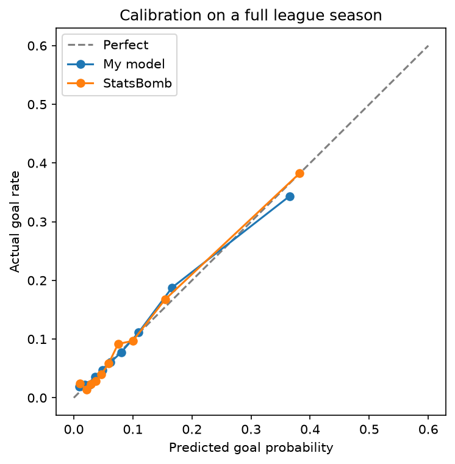
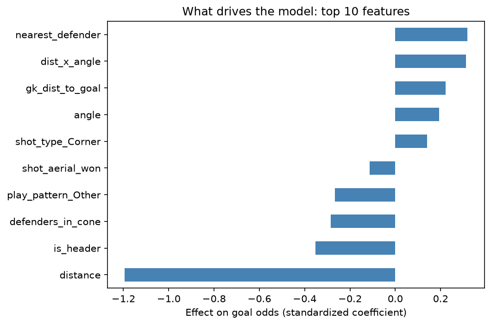

# Expected Goals (xG) Model with StatsBomb Open Data

**Question:** How close can a simple, interpretable model get to a commercial xG model?

## Summary
I built an xG model on ~9,800 open-play shots from a full league season using
StatsBomb's free event data. A logistic regression model reaches a log loss of
0.258, compared with 0.253 for StatsBomb's own xG.

## Results
| Model | Log loss | ROC AUC |
|---|---|---|
| No skill (average goal rate) | 0.3088 | - |
| Distance + angle | 0.2783 | 0.732 |
| + header, shot type | 0.2711 | 0.755 |
| + freeze-frame (defenders, keeper) | 0.2605 | 0.781 |
| + curve terms (final) | 0.2577 | 0.785 |
| Gradient boosting | 0.2607 | 0.776 |
| StatsBomb xG (benchmark) | 0.2525 | 0.795 |

## Findings
- Freeze-frame features (defenders in the shot path, keeper position) were the biggest improvement.
- Logistic regression matched or beat gradient boosting at this data size, and is easier to explain.
- Context features (first-time shots, play pattern, pressure) added very little.
- The model is well calibrated: predicted probabilities closely match actual goal rates, with slight over-prediction on the highest-quality chances (about 37% predicted vs. 34% actual).
- Distance from goal is the dominant driver of the model. Distance, angle, and their interaction are all derived from shot location and overlap heavily, so individual coefficients among them shouldn't be over-interpreted; the freeze-frame features (defenders in the shot path, keeper position) add independent signal.

## Method
Data: StatsBomb open data via `statsbombpy`. Penalties and shootouts excluded.
Features: distance, angle, body part, shot type, freeze-frame features, context flags.
Evaluation: 5-fold cross-validation, log loss and ROC AUC, calibration curves.

## Limitations
- Trained on one league season; results may differ in other leagues.
- StatsBomb's model uses more data and richer inputs, so it is a strong benchmark.

## Run it yourself
1. `python -m venv .venv` and activate it
2. `pip install -r requirements.txt`
3. Run the notebooks in order (data is downloaded from StatsBomb, not stored in this repo)
4. Run notebooks 01 to 04 in order; each one saves its output to `data/` for the next
- 
